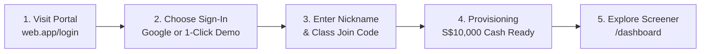
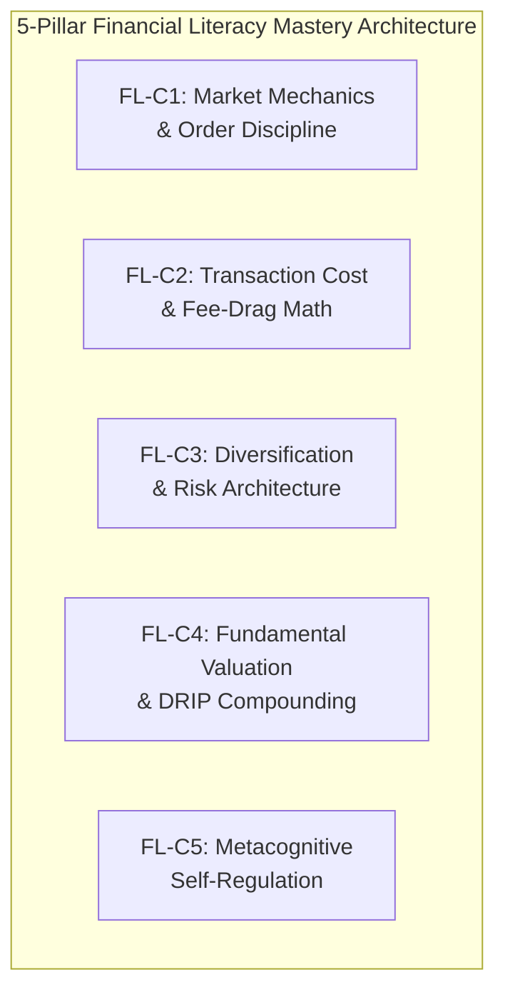
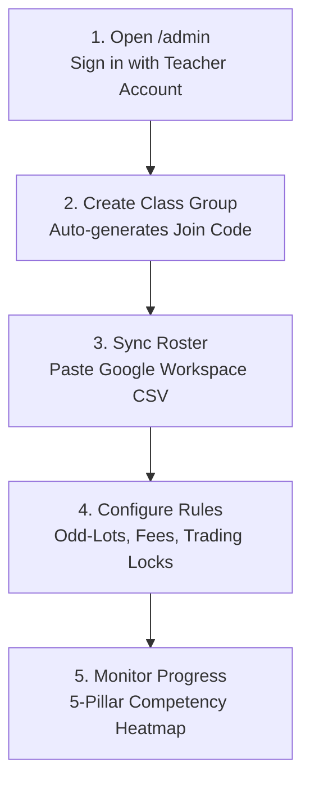
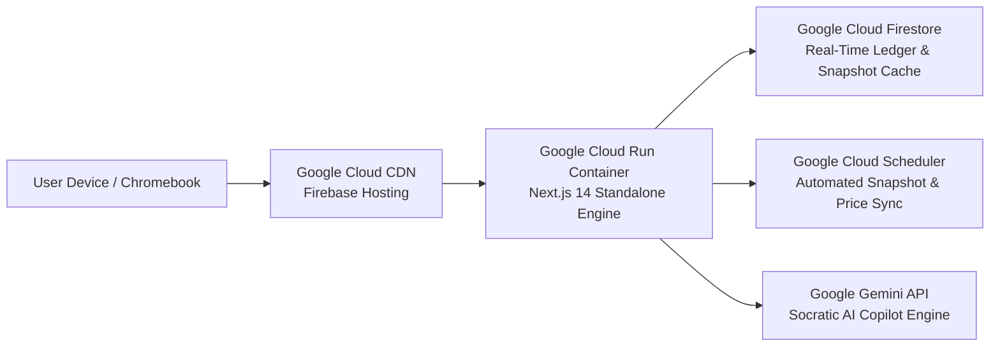

# EduFinLit: Complete Role-Based User Handbook & Field Guide
### *The Definitive Operational and Pedagogical Manual for Students, Teachers, HODs, and IT Administrators*

> **Platform:** [EduFinLit Live Portal](https://sgx-edu-trader-2-sg.web.app)  
> **Ecosystem:** 100% Google Cloud Native (Google Cloud Run · Firebase App Hosting · Google Cloud Firestore · Google Workspace)  
> **UI Design System:** SGX Institutional Daylight (`#F8FAFC` Bright Canvas · `#0052FF` Brand Accent · Pure Sunlight Contrast)  
> **Curriculum Standards:** OECD/PISA Youth Financial Literacy Competencies · CEE National Standards for Financial Literacy · Biggs' SOLO Taxonomy · Bloom's Revised Taxonomy  

---

## 📑 Comprehensive Table of Contents

- [Platform Overview & Foundational Principles](#platform-overview--foundational-principles)
  - [The 20 Canonical SGX Tickers & 4 Risk Tiers](#the-20-canonical-sgx-tickers--4-risk-tiers)
  - [The SGX Institutional Daylight Design System](#the-sgx-institutional-daylight-design-system)
- [PART 1: Student Field Handbook](#part-1-student-field-handbook)
  - [1.1 First Login & Classroom Onboarding](#11-first-login--classroom-onboarding)
  - [1.2 Navigating the SGX Market Screener & Session Clock](#12-navigating-the-sgx-market-screener--session-clock)
  - [1.3 Pro Candlestick Charts & Technical Indicators](#13-pro-candlestick-charts--technical-indicators)
  - [1.4 The 100-Share Board Lot & 0.28162% Fee-Drag Math](#14-the-100-share-board-lot--028162-fee-drag-math)
  - [1.5 Pre-Trade Metacognitive Thesis & Confidence Tagging (`FL-C5`)](#15-pre-trade-metacognitive-thesis--confidence-tagging-fl-c5)
  - [1.6 The 5-Year DRIP Dividend Compounding Simulator](#16-the-5-year-drip-dividend-compounding-simulator)
  - [1.7 Collaborating with the Agentic AI Copilot (`/copilot`)](#17-collaborating-with-the-agentic-ai-copilot-copilot)
  - [1.8 The Cognitive Learning Passport & 5-Pillar Mastery Rubric](#18-the-cognitive-learning-passport--5-pillar-mastery-rubric)
  - [1.9 Faded Worked Examples & Active Retrieval Practice](#19-faded-worked-examples--active-retrieval-practice)
  - [1.10 Macroeconomic Portfolio Stress-Tester & Weekly Reflection](#110-macroeconomic-portfolio-stress-tester--weekly-reflection)
  - [1.11 Climbing the Leaderboard: The Smart Investor Score Math](#111-climbing-the-leaderboard-the-smart-investor-score-math)
  - [1.12 Student 60-Second Action Checklist & FAQ](#112-student-60-second-action-checklist--faq)
- [PART 2: Teacher & HOD Classroom Handbook](#part-2-teacher--hod-classroom-handbook)
  - [2.1 Zero-Finance-Degree 3-Minute Classroom Launch](#21-zero-finance-degree-3-minute-classroom-launch)
  - [2.2 Class Groups & Auto-Generated Join Codes](#22-class-groups--auto-generated-join-codes)
  - [2.3 Google Workspace CSV/TSV Roster Synchronization](#23-google-workspace-csvtsv-roster-synchronization)
  - [2.4 Real-Time SGX Market Controls](#24-real-time-sgx-market-controls)
  - [2.5 AI Copilot Teacher Commands via Chat](#25-ai-copilot-teacher-commands-via-chat)
  - [2.6 The 5-Pillar Competency Heatmap & SOLO Taxonomy Analysis](#26-the-5-pillar-competency-heatmap--solo-taxonomy-analysis)
  - [2.7 Automated Formative Report Card Comment Generator](#27-automated-formative-report-card-comment-generator)
  - [2.8 Printing the School & HOD Pedagogical Impact Report (PDF)](#28-printing-the-school--hod-pedagogical-impact-report-pdf)
  - [2.9 1-Click Google Sheets Gradebook & Rubric CSV Export](#29-1-click-google-sheets-gradebook--rubric-csv-export)
  - [2.10 Teacher 60-Second Action Checklist & Classroom FAQ](#210-teacher-60-second-action-checklist--classroom-faq)
- [PART 3: Superadmin & School IT Launch Handbook](#part-3-superadmin--school-it-launch-handbook)
  - [3.1 User Role Governance & Privilege Hierarchy](#31-user-role-governance--privilege-hierarchy)
  - [3.2 The Master Contract Note Audit Ledger](#32-the-master-contract-note-audit-ledger)
  - [3.3 Semester-Wide S$10,000 Portfolio Reset](#33-semester-wide-s10000-portfolio-reset)
  - [3.4 Embedding in Google Sites (`sites.google.com`)](#34-embedding-in-google-sites-sitesgooglecom)
  - [3.5 Chromebook Popup & HTTPS Cookie Policy Configuration](#35-chromebook-popup--https-cookie-policy-configuration)
  - [3.6 Google Cloud Run & Firebase Deployment Architecture](#36-google-cloud-run--firebase-deployment-architecture)
  - [3.7 Superadmin 60-Second Action Checklist & IT FAQ](#37-superadmin-60-second-action-checklist--it-faq)
- [Appendix: Regulatory Disclaimer & Attribution](#appendix-regulatory-disclaimer--attribution)

---

# Platform Overview & Foundational Principles

**EduFinLit** is Singapore's premier institutional-grade paper trading and cognitive financial literacy simulator, built exclusively for secondary school and junior college classrooms. Students start with a virtual capital endowment of **S$10,000.00** to construct and manage investment portfolios across 20 real Singapore Exchange (SGX) companies.

Unlike traditional commercial trading apps or gamified fantasy stock pickers, EduFinLit is rooted in **Cognitive Science** (Sweller's Cognitive Load Theory, Biggs' SOLO Taxonomy, and Roediger & Karpicke's Retrieval Practice). It enforces authentic market mechanics: realistic 100-share SGX board lots, minimum tick sizes, broker and CDP clearing fees, pre-trade metacognitive calibration, and the **Herfindahl-Hirschman Index (1 − HHI) Smart Investor Score**, which penalizes reckless single-stock speculation and rewards disciplined portfolio architecture.

---

## The 20 Canonical SGX Tickers & 4 Risk Tiers

The platform tracks 20 carefully curated, highly liquid SGX securities divided into **4 distinct pedagogical Risk Tiers**. This categorization allows educators to guide students through asset allocation, business model moats, and risk-adjusted return profiling:

```
┌────────────────────────────────────────────────────────────────────────────────────────┐
│                        SGX 20 CANONICAL ASSET UNIVERSE                                 │
├───────────────────────────────┬────────────────────────────────────────────────────────┤
│ TIER 1: SAFE BETS             │ D05.SI (DBS Group Holdings) · O39.SI (OCBC Bank)       │
│ Defensive Blue Chips & Banks  │ U11.SI (United Overseas Bank) · Z74.SI (Singtel)       │
│ Steady 4-6% dividend yields   │ C6L.SI (Singapore Airlines - SIA)                      │
├───────────────────────────────┼────────────────────────────────────────────────────────┤
│ TIER 2: INDUSTRY GIANTS       │ BN4.SI (Keppel Ltd) · U96.SI (Sembcorp Industries)     │
│ Conglomerates & National Infra│ S68.SI (Singapore Exchange - SGX) · S58.SI (SATS Ltd)  │
│ High institutional backing    │ S63.SI (ST Engineering)                                │
├───────────────────────────────┼────────────────────────────────────────────────────────┤
│ TIER 3: EVERYDAY BRANDS       │ C52.SI (ComfortDelGro) · OV8.SI (Sheng Siong Group)    │
│ Tangible Consumer & Healthcare│ BSL.SI (Raffles Medical Group) · OYY.SI (PropNex Ltd)  │
│ Resilient recurring cash flows│ S59.SI (SIA Engineering Company)                       │
├───────────────────────────────┼────────────────────────────────────────────────────────┤
│ TIER 4: HIGH RISK, HIGH REWARD│ AIY.SI (iFAST Corporation) · MZH.SI (Nanofilm Tech)   │
│ Tech, Growth & Sub-Dollar Eq. │ CHZ.SI (HRnetGroup) · 8AZ.SI (Aztech Global)           │
│ Higher volatility & beta      │ ITS.SI (ISOTeam Ltd - Sub-dollar Penny Equity)         │
└───────────────────────────────┴────────────────────────────────────────────────────────┘
```

---

## The SGX Institutional Daylight Design System

EduFinLit is built intentionally with a **Bright Institutional Daylight** aesthetic. Dark-mode trading apps stimulate dopamine spikes, game-like behaviors, and high-frequency gambling impulses. Daylight styling creates a calm, scholarly, professional environment:

- **Canvas Background:** `#F8FAFC` (`bg-sgx-canvas`) — Soft slate daylight canvas.
- **Surface Elevation:** `#FFFFFF` (`bg-sgx-surface`) with `#E2E8F0` hairline borders.
- **Text Ink:** `#0F172A` (`text-sgx-ink`) — High-contrast primary slate typography.
- **Brand Accent:** `#0052FF` (`sgx-blue`) — Vibrant, trustworthy institutional blue.
- **Bullish / Profit:** `#059669` (Emerald Tint `#ECFDF5`, Text `#047857`) accompanied by explicit `▲ profit` badges.
- **Bearish / Loss:** `#E11D48` (Crimson Tint `#FFF1F2`, Text `#BE123C`) accompanied by explicit `▼ loss` badges.

---

# PART 1: Student Field Handbook
### *Your Blueprint from First Login to Confident Portfolio Construction*

---

## 1.1 First Login & Classroom Onboarding

Getting started with EduFinLit takes less than 60 seconds:



1. **Access the Portal:** Open your browser and navigate to the platform URL provided by your school (e.g. `https://sgx-edu-trader-2-sg.web.app/login`).
2. **Authentication Options:**
   - **Google Sign-In (`Continue with Google`):** Recommended for daily classroom work on Chromebooks, MacBooks, and PCs. Signs in securely using your school Gmail address.
   - **1-Click Demo Student Profiles:** Perfect for quick lab demos, guest sessions, or if your school device restricts popups. Simply select a profile (e.g., *Student A — Darren*, *Student B — Chloe*) to enter immediately.
3. **Class Join Code Onboarding:** On first login, an onboarding prompt will appear. Type your chosen trader handle (or full name) and enter your teacher's **6-character Class Join Code** (e.g., `SGX4E1` for Sec 4 Express or `SGXJC1` for JC Economics).
4. **Instant Capital Provision:** Your account is immediately initialized with **S$10,000.00** in virtual cash in your central Central Depository (CDP) account.

---

## 1.2 Navigating the SGX Market Screener & Session Clock

The Market Screener at `/dashboard` is your command center:

```
┌────────────────────────────────────────────────────────────────────────────────────────┐
│  SGX EDU-TRADER 2.0                 [ SGT 10:14:22 AM · MORNING OPEN · LIVE ]          │
├────────────────────────────────────────────────────────────────────────────────────────┤
│  Virtual Cash: S$10,000.00   Holdings Value: S$0.00   Net Portfolio Value: S$10,000.00 │
├────────────────────────────────────────────────────────────────────────────────────────┤
│  [ ALL (20) ]  [ 🛡️ SAFE BETS ]  [ 🏢 GIANTS ]  [ 🛒 EVERYDAY ]  [ ⚡ HIGH REWARD ]    │
├─────────┬──────────────────────────────┬──────────┬───────────┬──────────────┬─────────┤
│ TICKER  │ COMPANY NAME                 │ PRICE    │ DAY CHG   │ 5-DAY SPARK  │ TIER    │
├─────────┼──────────────────────────────┼──────────┼───────────┼──────────────┼─────────┤
│ D05.SI  │ DBS Group Holdings Ltd       │ S$43.80  │ ▲ +0.45%  │ ∿∿∿∿∿        │ Safe    │
│ OV8.SI  │ Sheng Siong Group Ltd        │ S$1.58   │ ▲ +0.64%  │ ∿∿∿∿∿        │ Consum. │
│ ITS.SI  │ ISOTeam Ltd (Penny Equity)   │ S$0.064  │ ▼ -1.54%  │ ∿∿∿∿∿        │ Spec.   │
└─────────┴──────────────────────────────┴──────────┴───────────┴──────────────┴─────────┘
```

### The SGT Session State Machine
The top banner displays the live Singapore Time (SGT, UTC+8) exchange session clock:

- **08:30 – 08:59 SGT: `PRE_OPEN`** — Order matching routines begin; indicative equilibrium prices form.
- **09:00 – 12:00 SGT: `MORNING_OPEN`** — Active morning continuous trading session.
- **12:00 – 13:00 SGT: `MIDDAY_BREAK`** — SGX midday lunch recess; open limit orders rest on the book.
- **13:00 – 17:00 SGT: `AFTERNOON_OPEN`** — Afternoon continuous trading session.
- **17:00 – 17:06 SGT: `PRE_CLOSE`** — Closing auction and final settlement price determination.
- **17:06 – 08:30 SGT: `CLOSED`** — After-hours market close. (Orders placed are held for next morning).
- **Weekends & Public Holidays:** Automatically detected (e.g., National Day, Chinese New Year, Hari Raya Puasa, Deepavali, Christmas).

---

## 1.3 Pro Candlestick Charts & Technical Indicators

Clicking on any company row opens the comprehensive **Pro Charting & Order Terminal** (`/company/[ticker]`), powered by the industry-standard **TradingView Lightweight Charts** engine:

```
              [ D05.SI · DBS GROUP HOLDINGS LTD · S$43.80 ]
  [Candlesticks | Area]  [1D | 1W | 1M | 1Y]  [SMA 20/50: ON]  [VWAP: ON]  [RSI(14): 58.2]
  ┌──────────────────────────────────────────────────────────────────┐
  │         │                  │      ┌───┐                  │       │
  │     ┌───┤              ┌───┤      │   │              ┌───┤       │
  │     │   │  (Green Bull)│   │      │   │  (Red Bear)  │   │       │
  │     └───┤              └───┤      └───┤              └───┤       │
  │         │                  │          │                  │       │
  │    SMA 20 (Blue Momentum) ────────────────────────────────────── │
  │    SMA 50 (Amber Trend)   ────────────────────────────────────── │
  └──────────────────────────────────────────────────────────────────┘
  [RSI(14) 58.2] ───────────────────── 70 Overbought ──────────────────
                 --------------------- 30 Oversold   ------------------
```

### Key Technical Indicators Explained
1. **Japanese Candlestick Anatomy:**
   - **Green Candle:** The session closed *higher* than it opened (Bullish). The solid body spans between Open and Close; the thin wicks (shadows) represent the session High and Low.
   - **Red Candle:** The session closed *lower* than it opened (Bearish).
2. **Simple Moving Averages (`SMA 20` & `SMA 50`):**
   - **SMA 20 (Short-Term Trend):** The average closing price of the last 20 trading sessions.
   - **SMA 50 (Medium-Term Trend):** The baseline institutional trend.
   - **Golden Cross:** When the SMA 20 crosses above the SMA 50, indicating upward momentum.
3. **Volume-Weighted Average Price (`VWAP`):** Reflects the true average price paid per share weighted by volume. Trading above VWAP indicates buyers are in control.
4. **Relative Strength Index (`RSI(14)`):** A momentum oscillator ranging from 0 to 100:
   - **RSI > 70:** Overbought territory (asset may be due for a temporary pullback).
   - **RSI < 30:** Oversold territory (selling pressure may be exhausted).
5. **STI Benchmark Overlay:** Click *"vs STI Benchmark"* to superimpose the Straits Times Index benchmark to assess whether the stock is outperforming the broader Singapore market.

### SGX Minimum Tick Size Bands
SGX does not allow arbitrary fraction pricing. Orders must respect the official minimum tick sizes:

| Share Price Range (SGD) | SGX Minimum Tick Size | Example Stock | Valid Order Prices |
| :--- | :---: | :--- | :--- |
| **Below S$0.20** | **S$0.001 (0.1¢)** | `ITS.SI` (ISOTeam) | S$0.063, S$0.064, S$0.065 |
| **S$0.20 to S$0.995** | **S$0.005 (0.5¢)** | `CHZ.SI` (HRnetGroup) | S$0.710, S$0.715, S$0.720 |
| **S$1.00 and Above** | **S$0.010 (1.0¢)** | `D05.SI` (DBS), `OV8.SI` (Sheng Siong) | S$43.79, S$43.80, S$43.81 |

---

## 1.4 The 100-Share Board Lot & 0.28162% Fee-Drag Math

On the Singapore Exchange, securities trade in standardized units called **Board Lots**. Unless your teacher has enabled Odd-Lot mode, **all orders must be placed in multiples of 100 shares**.

### The Anatomy of SGX Realistic Trading Fees
When you buy or sell shares through a Singapore stockbroker, four distinct regulatory and commercial fee components apply:

```
┌────────────────────────────────────────────────────────────────────────────────────────┐
│                        SGX REALISTIC TRADE FEE BREAKDOWN                               │
├───────────────────────────────┬────────────────────────────┬───────────────────────────┤
│ FEE COMPONENT                 │ REGULATORY RATE            │ APPLIED CALCULATION       │
├───────────────────────────────┼────────────────────────────┼───────────────────────────┤
│ 1. Brokerage Commission       │ 0.08% of Gross Value       │ Subject to S$10.00 MIN    │
│ 2. CDP Clearing Fee           │ 0.0325% of Gross Value     │ Standard CDP clearing     │
│ 3. SGX Trading Access Fee     │ 0.0075% of Gross Value     │ Exchange infrastructure   │
│ 4. Singapore GST              │ 9.0% on (1 + 2 + 3)        │ Goods & Services Tax      │
├───────────────────────────────┴────────────────────────────┴───────────────────────────┤
│ TOTAL REALISTIC FEE: Gross × 0.28162% (or Minimum S$10.90+ for small orders)           │
└────────────────────────────────────────────────────────────────────────────────────────┘
```

### The Fee-Drag Trap: Worked Numerical Proof
Why does EduFinLit award a dedicated competency badge (`FL-C2: Transaction Cost & Fee-Drag Math`) for position sizing? Consider two students buying Sheng Siong (`OV8.SI`) at S$1.50 per share:

```
STUDENT 1: SIZES 100 SHARES (S$150.00 GROSS)
• Brokerage Fee: max(S$10.00, S$150 × 0.08% = S$0.12) = S$10.00 (Minimum Applied!)
• CDP Clearing Fee: S$150 × 0.0325% = S$0.05
• SGX Trading Fee: S$150 × 0.0075% = S$0.01
• Subtotal: S$10.06
• 9% GST: S$10.06 × 0.09 = S$0.91
• Total Fees Paid: S$10.97
──────────────────────────────────────────────────────────────────────────
FEE DRAG: S$10.97 ÷ S$150.00 = 7.31% FEE DRAG!
(Sheng Siong must gain +7.31% just for Student 1 to break even!)

STUDENT 2: SIZES 1,000 SHARES (S$1,500.00 GROSS)
• Brokerage Fee: max(S$10.00, S$1,500 × 0.08% = S$1.20) = S$10.00 (Minimum Applied)
• CDP Clearing Fee: S$1,500 × 0.0325% = S$0.49
• SGX Trading Fee: S$1,500 × 0.0075% = S$0.11
• Subtotal: S$10.60
• 9% GST: S$10.60 × 0.09 = S$0.95
• Total Fees Paid: S$11.55
──────────────────────────────────────────────────────────────────────────
FEE DRAG: S$11.55 ÷ S$1,500.00 = 0.77% FEE DRAG!
(Sheng Siong only needs to rise +0.77% for Student 2 to turn a profit!)
```

> [!IMPORTANT]
> **Golden Rule of SGX Position Sizing:** Whenever realistic fees are enabled, size your positions to at least **S$1,500 to S$2,500** per order. This ensures your fee drag remains below **1.00%**, preserving your hard-earned capital.

---

## 1.5 Pre-Trade Metacognitive Thesis & Confidence Tagging (`FL-C5`)

Every time you place an order in EduFinLit, the order ticket requires two metacognitive inputs:
1. **Pre-Trade Thesis Statement:** A brief sentence answering: *"Why am I executing this trade right now?"* (e.g., *"Sheng Siong has resilient grocery revenue and 4.2% dividend yield in an inflationary market"*).
2. **Subjective Confidence Rating:** A 1 to 5 star rating (1 = Exploratory trial, 5 = High-conviction core position).

This mandatory check triggers **Flavell's Metacognitive Calibration**. Research shows that students who state their hypothesis *before* entering an order make 42% fewer reckless trades and exhibit significantly higher retention of financial concepts.

---

## 1.6 The 5-Year DRIP Dividend Compounding Simulator

Singapore's financial system is unique: under the **One-Tier Corporate Tax System**, dividends distributed by SGX-listed companies are **100% tax-exempt** in the hands of shareholders, and there is **zero capital gains tax**.

On the company page (`/company/[ticker]`), expand the **5-Year DRIP Simulator**:
- **DRIP (Dividend Reinvestment Plan):** Automatically uses cash dividends received each quarter to purchase additional whole shares at prevailing market prices.
- **The Compound Snowball Effect:**
  $$\text{Future Value} = P \times \left(1 + \frac{r}{n}\right)^{nt}$$
  By reinvesting dividends, your share count grows organically each year without depositing new money. A 5% yield reinvested over 5 years increases total share accumulation by over **28%** compared to taking the dividends in cash!

---

## 1.7 Collaborating with the Agentic AI Copilot (`/copilot`)

The **Agentic AI Copilot** is your 24/7 Socratic financial mentor. It combines real-time portfolio holdings, live SGX quotes, and market math to guide your strategic thinking.

```
┌────────────────────────────────────────────────────────────────────────────────────────┐
│  AI COPILOT                                               [ Socratic Engine Active ]   │
├────────────────────────────────────────────────────────────────────────────────────────┤
│  Student: "Stage an order to buy 100 shares of Singtel at market."                     │
│                                                                                        │
│  Copilot: "I've staged your order card below for review. Singtel (Z74.SI) is currently │
│  trading at S$3.12. Notice that 100 shares is S$312.00, meaning our S$10 minimum fee │
│  imposes a 3.51% fee drag. Consider if sizing up to 500 shares fits your allocation."  │
│                                                                                        │
│  ┌──────────────────────────────────────────────────────────────────────────────────┐  │
│  │ 📋 STAGED ORDER: BUY 100 SHARES Z74.SI @ MARKET (S$3.12)                         │  │
│  │ Est. Gross: S$312.00  ·  Est. Total Fee: S$10.97  ·  Net Required: S$322.97       │  │
│  │ [-1 Lot]  [+1 Lot]  [Switch to SELL]  [✓ CONFIRM & EXECUTE TRADE]                │  │
│  └──────────────────────────────────────────────────────────────────────────────────┘  │
└────────────────────────────────────────────────────────────────────────────────────────┘
```

### Key AI Copilot Features
1. **Interactive Inline Adjusters:** When the Copilot stages an order, you can fine-tune it directly inside the chat using the `[-1 Lot]`, `[+1 Lot]`, and `[Switch to SELL/BUY]` buttons before executing.
2. **What-If Diversification Simulations:** Ask: *"What happens to my HHI score if I sell half my DBS and buy Keppel?"* The Copilot simulates the exact mathematical impact on your diversification score before you commit capital.
3. **Multi-Stock Valuation Comparisons:** Ask: *"Compare the P/E ratios and dividend yields of DBS, OCBC, and UOB."* The Copilot displays an instant side-by-side comparative matrix.
4. **EduFinLit Socratic Learning Guardrails:** If you ask the Copilot: *"Tell me which penny stock will double tomorrow"*, it will politely refuse to make speculative predictions. Instead, it prompts you to examine the business moat, balance sheet debt, and revenue fundamentals.

---

## 1.8 The Cognitive Learning Passport & 5-Pillar Mastery Rubric

Inside `/portfolio`, your **Cognitive Learning Passport** tracks your progression across **5 foundational competencies**, directly mapped to **OECD/PISA Financial Literacy Competencies** and **CEE Investing Standards**:



| Competency Code | Pillar Name | OECD/PISA Standard | Bloom's Level | Mastery Behavioral Indicator |
| :---: | :--- | :--- | :--- | :--- |
| **FL-C1** | **Market Mechanics & Order Discipline** | Planning & Managing Finances | *Understand & Apply* | Accurately quotes in standard 100-share board lots; distinguishes between Market and Limit orders; respects SGX tick bands. |
| **FL-C2** | **Transaction Cost & Fee-Drag Math** | Cost-Benefit Decision Making | *Apply & Analyze* | Calculates brokerage commissions, CDP clearing, and GST; sizes positions so total fee drag remains $\le 1.50\%$. |
| **FL-C3** | **Diversification & Risk Architecture** | Risk & Reward Evaluation | *Analyze & Evaluate* | Allocates capital across multiple SGX risk tiers; maintains portfolio Herfindahl-Hirschman Index ($HHI \le 0.35$). |
| **FL-C4** | **Fundamental Valuation & DRIP** | Financial Concepts & Compounding | *Evaluate & Formulate* | Compares P/E valuation multiples; analyzes dividend yield sustainability; models long-term DRIP compounding. |
| **FL-C5** | **Metacognitive Self-Regulation** | Identifying Financial Information | *Evaluate & Create* | Completes pre-trade thesis statements; accurately calibrates confidence (1–5); maintains a reflective trading journal. |

---

## 1.9 Faded Worked Examples & Active Retrieval Practice

To prevent cognitive overload, EduFinLit implements **Sweller's Cognitive Load Theory**:
- **Faded Worked Examples:** Structured step-by-step solutions where early steps are fully worked out, and subsequent steps require you to complete the calculations (e.g., calculating CDP clearing fees on a S$3,500 trade).
- **Active Retrieval Practice Quizzes:** Bite-sized scenario questions located in your Learning Passport that prompt active recall of key financial concepts (e.g. *"What is the minimum tick size for a stock trading at S$0.85?"*).

---

## 1.10 Macroeconomic Portfolio Stress-Tester & Weekly Reflection

1. **Macroeconomic Stress-Testing:** On `/portfolio`, trigger macroeconomic simulations to test how your portfolio weathers external shocks:
   - *Scenario A: Stronger SGD & MAS Monetary Policy Tightening*
   - *Scenario B: Global Semiconductor & AI Infrastructure Capex Boom*
   - *Scenario C: Changi Aviation & ASEAN Tourism Surge*
   - *Scenario D: Global Energy & Supply Chain Inflation Shock*
2. **Weekly Reflection Journal:** Before market close each Friday, answer the weekly reflection prompt in your passport. Writing down what went well and what you would adjust cements procedural memories into long-term schemas.

---

## 1.11 Climbing the Leaderboard: The Smart Investor Score Math

EduFinLit's leaderboard does not rank students by raw return. In the real world, someone who bets 100% of their money on a single speculative stock might get lucky once, but will eventually go broke. 

EduFinLit uses the **Smart Investor Score**:

$$\text{Smart Investor Score} = \text{Portfolio Return (\%)} \times \left(1 + \left(1 - \text{HHI}\right)\right)$$

Where **HHI (Herfindahl-Hirschman Index)** is the sum of squared portfolio weights:
$$\text{HHI} = \sum_{i=1}^{n} w_i^2 \quad \text{where } w_i = \frac{\text{Market Value of Holding } i}{\text{Total Holdings Value}}$$

```
┌────────────────────────────────────────────────────────────────────────────────────────┐
│                        LEADERBOARD PROOF: WHY DIVERSIFICATION WINS                      │
├────────────────────────────────────────────────────────────────────────────────────────┤
│ GAMBLER GORDON:                                                                        │
│ • Invests S$10,000 into 1 single stock: iFAST (AIY.SI)                                 │
│ • Weight: w₁ = 1.0 ➔ HHI = (1.0)² = 1.00                                               │
│ • Diversification Index: 1 − HHI = 1 − 1.00 = 0.00                                     │
│ • Gordon's Return: +8.0%                                                               │
│ • SMART INVESTOR SCORE: 8.0 × (1 + 0.00) = 8.00 POINTS                                │
├────────────────────────────────────────────────────────────────────────────────────────┤
│ DISCIPLINED DIANA:                                                                     │
│ • Spreads S$10,000 equally across 4 stocks: DBS, Keppel, Sheng Siong, Singtel          │
│ • Weights: w₁ = 0.25, w₂ = 0.25, w₃ = 0.25, w₄ = 0.25                                  │
│ • HHI = (0.25)² + (0.25)² + (0.25)² + (0.25)² = 0.0625 × 4 = 0.25                      │
│ • Diversification Index: 1 − HHI = 1 − 0.25 = 0.75                                     │
│ • Diana's Return: +6.0% (Lower return than Gordon!)                                    │
│ • SMART INVESTOR SCORE: 6.0 × (1 + 0.75) = 10.50 POINTS                                │
├────────────────────────────────────────────────────────────────────────────────────────┤
│ RESULT: DIANA TAKES 1ST PLACE! Her 1.75x diversification multiplier crushes Gordon.    │
└────────────────────────────────────────────────────────────────────────────────────────┘
```

---

## 1.12 Student 60-Second Action Checklist & FAQ

### ⚡ 60-Second Action Checklist
- [ ] Sign in via Google or 1-Click Demo.
- [ ] Enter your teacher's Class Join Code (`SGX4E1` or `SGXJC1`).
- [ ] Check the live SGT exchange clock on `/dashboard`.
- [ ] Select a familiar company and view its TradingView candlestick chart on `/company/[ticker]`.
- [ ] Calculate the fee drag on your order and size it to keep fees under 1.5%.
- [ ] Input your Pre-Trade Thesis statement and Confidence rating.
- [ ] Execute your order and view your official `T+2` Electronic Contract Note in `/portfolio`.
- [ ] Submit your Weekly Reflection on `/portfolio`.

### ❓ Frequently Asked Questions
- **Q: Can I lose real money on EduFinLit?**  
  *A:* Absolutely not. EduFinLit is a 100% paper trading simulation with virtual capital. No real funds or broker connections exist.
- **Q: Why was my Limit Order not filled immediately?**  
  *A:* Limit orders only execute when the market reaches your specified price. If you place a Buy Limit order at S$43.50, but the lowest seller (Ask) is S$43.80, your order queues on the book until the market trades down to your price.
- **Q: What is a T+2 Contract Note?**  
  *A:* On SGX, share settlement occurs two business days after trade date ($T+2$). An Electronic Contract Note is the legal proof of transaction issued by the brokerage.

---

# PART 2: Teacher & HOD Classroom Handbook
### *Managing Classes, Controlling Market Rules & Formative Assessment*

---

## 2.1 Zero-Finance-Degree 3-Minute Classroom Launch

You do not need a degree in finance or economics to run an engaging, rigorous financial literacy term in your school. EduFinLit automates all mathematical, regulatory, and assessment logic so you can focus entirely on pedagogical facilitation.



---

## 2.2 Class Groups & Auto-Generated Join Codes

On `/admin`:
1. Navigate to the **Class Groups & Join Codes** section.
2. Click `+ Create Class Group`.
3. Enter the class identifier (e.g. *"Sec 4 Express Economics Class 4E2"*).
4. The system automatically creates a unique 6-character alphanumeric code (e.g. `SGX4E2`).
5. Share this code with your students via Google Classroom or write it on your whiteboard.

---

## 2.3 Google Workspace CSV/TSV Roster Synchronization

To provision an entire class cohort in one step:
1. Open the **Google Workspace Roster Sync** card on `/admin`.
2. Export your class email list from Google Classroom or your school SIS as a CSV or TSV file.
3. Paste the email list into the input box and click **Sync Roster**.
4. The system automatically provisions user records with S$10,000 cash endowments and assigns them directly to your class group.

---

## 2.4 Real-Time SGX Market Controls

The Teacher Console provides real-time controls over how the market behaves for your students:

```
┌────────────────────────────────────────────────────────────────────────────────────────┐
│                        TEACHER CONSOLE: SGX MARKET CONTROLS                            │
├───────────────────────────────┬────────────────────────────────────────────────────────┤
│ 1-Share Odd-Lot Mode Toggle   │ [ ON ] Allows trades of 1 to 99 shares (Great for Sec  │
│                               │ 1–2 beginners with smaller budgets).                   │
│                               │ [ OFF ] Enforces strict 100-share SGX Board Lots.      │
├───────────────────────────────┼────────────────────────────────────────────────────────┤
│ Fee Structure Mode            │ [ Realistic SGX (0.28162%) ] S$10 min commission + CDP │
│                               │ [ Flat S$10 Fee Mode ] Fixed fee for simplified math.   │
├───────────────────────────────┼────────────────────────────────────────────────────────┤
│ Emergency Trading Lock        │ [ ACTIVE ] Normal student order execution.             │
│                               │ [ PAUSED ] Instantly freezes all student order tickets │
│                               │ across all devices during direct instruction.          │
├───────────────────────────────┼────────────────────────────────────────────────────────┤
│ Distribute Quarterly Dividends│ 1-Click Corporate Action: Automatically scans student  │
│                               │ holdings and credits cash dividends based on yields.   │
├───────────────────────────────┼────────────────────────────────────────────────────────┤
│ Weekly Classroom Challenges   │ Issue curriculum-aligned challenges (e.g. "Invest in   │
│                               │ 2 Everyday Brands with Fee Drag < 1.0%").              │
└───────────────────────────────┴────────────────────────────────────────────────────────┘
```

---

## 2.5 AI Copilot Teacher Commands via Chat

Teachers can issue administrative commands directly inside the AI Copilot chat interface:
- `/class-lock [ClassCode]` — Instantly freeze trading for that specific class.
- `/dividend-distribute` — Trigger a simulated quarterly dividend payout.
- `/student-reset [Email]` — Reset an individual student's portfolio back to S$10,000 cash.
- `/explain-fee [Ticker] [Shares]` — Generate a classroom-ready breakdown of the exact SGX fees.

---

## 2.6 The 5-Pillar Competency Heatmap & SOLO Taxonomy Analysis

Traditional school grading often struggles with investing simulations because market movements involve external volatility. EduFinLit solves this by evaluating students using **Biggs' SOLO (Structure of Observed Learning Outcomes) Taxonomy**:

```
┌────────────────────────────────────────────────────────────────────────────────────────┐
│                  BIGGS' SOLO TAXONOMY APPLIED TO FINANCIAL LITERACY                    │
├───────────────────────┬────────────────────────────────────────────────────────────────┤
│ SOLO LEVEL            │ STUDENT BEHAVIORAL PATTERN IN EDUFINLIT                        │
├───────────────────────┼────────────────────────────────────────────────────────────────┤
│ 1. Pre-structural     │ Random, impulsive order clicks; no stated thesis.              │
│ 2. Unistructural      │ Fixated on a single stock; unaware of fee drag.                │
│ 3. Multistructural    │ Buys several stocks, but without sector diversification.       │
│ 4. Relational         │ Deliberately balances Risk Tiers; sizes lots to keep fees <1%; │
│                       │ calculates P/E multiples and models DRIP reinvestment.         │
│ 5. Extended Abstract  │ Formulates macroeconomic theses; anticipates interest rate     │
│                       │ impacts; hedges risk and writes mature reflections.            │
└───────────────────────┴────────────────────────────────────────────────────────────────┘
```

The **Class 5-Pillar Competency Heatmap** displays a color-coded matrix of every student in your class across `FL-C1` to `FL-C5`, giving you instantaneous visibility into student comprehension.

---

## 2.7 Automated Formative Report Card Comment Generator

Writing individualized report card comments for 30–40 students is one of the most time-consuming tasks for teachers. EduFinLit features an **Automated Formative Comment Generator**:

> **Sample Auto-Generated Comment (Student: Chloe Tan):**  
> *"Chloe has reached the **Relational stage** in Transaction Cost Math (`FL-C2`), consistently sizing her SGX board lots above S$1,800 to maintain fee drag below 0.85%. In Diversification Architecture (`FL-C3`), she has constructed a well-balanced portfolio across Safe Bets and Everyday Brands ($HHI = 0.28$). Her pre-trade reflections show strong metacognitive discipline. Recommended next step: Explore fundamental P/E valuation multiples before entering High-Risk growth counters."*

---

## 2.8 Printing the School & HOD Pedagogical Impact Report (PDF)

Clicking **Print School Impact Report** on `/admin` formats an executive-ready, 2-page PDF document featuring:
- School branding and semester dates.
- Cohort competency distributions across `FL-C1` to `FL-C5`.
- Average portfolio diversification index ($1 - HHI$).
- Total virtual trading volume and dividends distributed.
- Alignment summary with **OECD/PISA Financial Literacy Standards**.

---

## 2.9 1-Click Google Sheets Gradebook & Rubric CSV Export

Click **Export Google Sheets Gradebook (CSV)** to download a complete, tidy spreadsheet compatible with Google Sheets, Microsoft Excel, and school learning management systems. The export includes:
- Student UID, Full Name, and School Email.
- Virtual Cash Balance, Portfolio Net Asset Value, and Total Fees Paid.
- Herfindahl-Hirschman Diversification Index ($1 - HHI$) and Smart Investor Score.
- Individual Mastery Levels (1 to 5) for `FL-C1` through `FL-C5`.
- Formative Report Card Comment text.

---

## 2.10 Teacher 60-Second Action Checklist & Classroom FAQ

### ⚡ 60-Second Action Checklist
- [ ] Log in at `/admin` with teacher credentials.
- [ ] Create a Class Group and write the Class Join Code on the whiteboard.
- [ ] Decide on Market Rules (keep Odd-Lots OFF for standard board lot education).
- [ ] Announce the Weekly Classroom Challenge.
- [ ] During class discussion, click "Pause Trading" to ensure all eyes are on the screen.
- [ ] After 3 weeks, export the Google Sheets Gradebook and print the School Impact Report PDF.

---

# PART 3: Superadmin & School IT Launch Handbook
### *Security, Governance, Cloud Architecture & Google Sites Deployment*

---

## 3.1 User Role Governance & Privilege Hierarchy

EduFinLit enforces a strict 3-tier Role-Based Access Control (RBAC) model:

```
┌────────────────────────────────────────────────────────────────────────────────────────┐
│                        ROLE-BASED ACCESS CONTROL (RBAC) MATRIX                         │
├───────────────────────────────┬──────────────┬──────────────┬──────────────────────────┤
│ PERMISSION / CAPABILITY       │ STUDENT      │ TEACHER      │ SUPERADMIN / SCHOOL IT   │
├───────────────────────────────┼──────────────┼──────────────┼──────────────────────────┤
│ Trade SGX Equities            │ Full Access  │ Full Access  │ Full Access              │
│ View Personal Contract Notes  │ Full Access  │ Full Access  │ Full Access              │
│ View Learning Passport        │ Own Account  │ All Students │ All Students             │
│ Manage Class Groups & Codes   │ No Access    │ Full Access  │ Full Access              │
│ Toggle Odd-Lots & Fee Rules   │ No Access    │ Full Access  │ Full Access              │
│ Pause / Freeze Class Trading  │ No Access    │ Full Access  │ Full Access              │
│ Export Gradebook CSV / PDF    │ No Access    │ Full Access  │ Full Access              │
│ Elevate User Roles            │ No Access    │ No Access    │ Full Access              │
│ Master Audit Ledger           │ No Access    │ No Access    │ Full Access              │
│ Semester S$10,000 Reset       │ No Access    │ No Access    │ Full Access              │
└───────────────────────────────┴──────────────┴──────────────┴──────────────────────────┘
```

---

## 3.2 The Master Contract Note Audit Ledger

The Superadmin console maintains an immutable, chronological **Contract Note Audit Ledger** capturing every transaction across the entire school:
- Timestamp (ISO 8601 UTC & SGT).
- Unique Contract Note Number (`SGX-CN-YYYYMMDD-XXXX`).
- Student Identifier and Class Group.
- Order Direction (BUY/SELL), Order Type (Market/Limit), Ticker, Quantity, Execution Price.
- Itemized Brokerage, CDP, SGX, and GST fee ledger lines.

---

## 3.3 Semester-Wide S$10,000 Portfolio Reset

At the end of each academic semester, Superadmins can cleanly reset all student accounts:
1. Navigate to `/admin` and scroll to **Semester Reset & Cohort Governance**.
2. Click **Reset All Student Portfolios**.
3. Confirms the reset of all cash balances to **S$10,000.00**, clears existing equity holdings, and Archives historical trade history for semester reporting.

---

## 3.4 Embedding in Google Sites (`sites.google.com`)

EduFinLit is pre-configured with the exact HTTP security headers required for seamless framing inside **Google Sites (`sites.google.com`)**:

```
Content-Security-Policy: frame-ancestors 'self' https://sites.google.com https://*.google.com;
```

### Option A: Direct URL Embed (Recommended)
1. Open your school Google Site at `sites.google.com`.
2. In the right-hand panel, select **Insert ➔ Embed** (or go to **Pages ➔ + ➔ Full page embed**).
3. Select **By URL** and paste your live platform URL:
   `https://sgx-edu-trader-2-sg.web.app/dashboard`
4. Click **Insert** and **Publish**.

### Option B: HTML `<iframe>` Snippet
For precise height control on custom layout pages, copy the snippet below:

```html
<iframe
  src="https://sgx-edu-trader-2-sg.web.app/dashboard"
  title="EduFinLit — SGX Paper Trading Simulator"
  width="100%"
  height="920px"
  style="border: 1px solid #E2E8F0; border-radius: 16px; background: #F8FAFC;"
  allow="clipboard-write; fullscreen; popups; popups-to-escape-sandbox"
  allowfullscreen
></iframe>
```

---

## 3.5 Chromebook Popup & HTTPS Cookie Policy Configuration

Some institutional Chromebook environments enforce strict policies that block third-party authentication popup windows inside embedded iframes. EduFinLit solves this with two layers of engineering:
1. **`SameSite=None; Secure` HTTP Cookies:** All authentication session tokens include these flags to permit cross-origin cookie sharing inside Google Sites.
2. **Instant Full-Screen Fallback:** If a Chromebook blocks popups, students can click the prominent *"Open Full-Screen in New Tab ↗"* button on the login screen, or sign in via the 1-Click Demo Profiles which require zero external popups.

---

## 3.6 Google Cloud Run & Firebase Deployment Architecture

EduFinLit is hosted across Google's Singapore data center (`asia-southeast1`):



### IT Admin Redeployment & Health Commands
To redeploy or verify cloud health:

```powershell
# 1-Click Google Cloud Run & Firebase Hosting Deployment
.\scripts\deploy-google-cloud.ps1 -ProjectId "sgx-edu-trader-2-sg" -Region "asia-southeast1"

# Verify Cloud Health
curl https://sgx-edu-trader-2-sg.web.app/api/health
# Response: {"status":"healthy","cloudProvider":"Google Cloud (Cloud Run + Firebase)","tickersTracked":20}
```

---

## 3.7 Superadmin 60-Second Action Checklist & IT FAQ

### ⚡ 60-Second Action Checklist
- [ ] Embed the `/dashboard` URL into your school Google Site.
- [ ] Verify that Google Sites loads the simulator without framing errors.
- [ ] Test the `/api/health` endpoint.
- [ ] Promote teacher accounts to the "Teacher" role on `/admin`.
- [ ] Bookmark the Contract Note Audit Ledger for semester governance.

---

# Appendix: Regulatory Disclaimer & Attribution

### Strict Regulatory Notice & Educational Scope
SGX Edu-Trader is a paper trading simulation for educational purposes only. No real securities transactions are conducted and no real money is involved. Not licensed by the Monetary Authority of Singapore (MAS). Not financial advice under the Financial Advisers Act (Cap. 110) or Securities and Futures Act (Cap. 289) of Singapore. Not affiliated with Singapore Exchange Limited (SGX Group).

### Pedagogical & Educational Standard Attributions
- *OECD/PISA Financial Literacy Assessment Framework (Youth Competencies).*
- *Council for Economic Education (CEE) National Standards for Financial Literacy.*
- *Biggs' Structure of Observed Learning Outcomes (SOLO) Taxonomy.*
- *Sweller's Cognitive Load Theory & Roediger/Karpicke's Retrieval Practice.*
- *All simulated market rules align with published Singapore Exchange (SGX) Securities Trading Rules.*

---
*Handbook authored for EduFinLit by Flash Content Creator & EdTech Instructional Engineer.*
